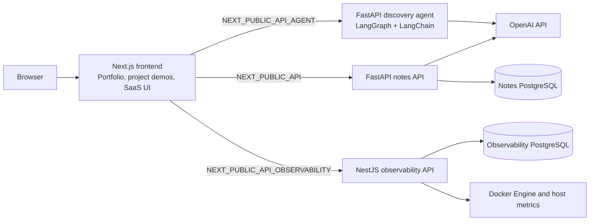

# AI Engineering Platform

A multi-service AI engineering project and portfolio. The repository brings together an adaptive project discovery agent, a notes summarization API, an infrastructure monitoring API, and a Next.js site that presents these projects alongside a personal portfolio and a SaaS dashboard.

## Architecture



The three backend services are separate processes with separate configuration and persistence needs. The frontend calls them directly from the relevant project pages; there is no shared backend gateway in the checked-in code. The Next.js app also has its own PostgreSQL-backed SaaS data layer, authentication, and Stripe routes.

## Services and implemented features

| Component | Responsibilities and current implementation |
| --- | --- |
| **Discovery agent** (`backend/agent`) | FastAPI service with a LangGraph workflow and LangChain structured LLM output. It conducts an adaptive six-step project interview, tracks explicit user facts separately from AI inferences, validates typed answers, and generates a structured final overview. Sessions and per-session locks are held in process memory, so state is lost on restart and is not shared between workers. |
| **Notes summarizer** (`backend/notes`) | FastAPI service backed by SQLAlchemy and PostgreSQL. It lists notes, creates notes, and generates/stores one-sentence summaries with the OpenAI client. An `/auth/register` route is present, but its handler references a `User` ORM model that is not defined/imported in the notes service, so account registration is incomplete. The notes API does not currently implement the update/delete routes described by the old README. |
| **Observability API** (`observability`) | NestJS service using Prisma/PostgreSQL, Dockerode, and scheduled collection. It samples host system metrics and running container metrics every 10 seconds, stores metric history, and records health-check results for enabled monitors. The frontend monitoring page requests system and container metrics. |
| **Frontend** (`frontend`) | Next.js 16 / React 19 / TypeScript app. It contains the personal portfolio and project pages, client integrations for the three services, plus a SaaS area with cookie-based sessions, user/team dashboard pages, Drizzle/PostgreSQL data access, and Stripe checkout/webhook handling. |

The repository also includes a separate RAG Chat link in the portfolio navigation that points to an external deployment. Its implementation is not part of this repository.

## Technology

- **Web:** Next.js, React, TypeScript, Tailwind CSS, shadcn-style UI components
- **Agent:** Python 3.11 (per `pyproject.toml`), FastAPI, LangGraph, LangChain, OpenAI integration
- **Notes:** Python 3.11 container, FastAPI, SQLAlchemy, PostgreSQL driver, OpenAI integration
- **Monitoring:** Node.js 22 container, NestJS, Prisma, PostgreSQL, Dockerode
- **Frontend data and billing:** Drizzle ORM, PostgreSQL, Stripe
- **Operations:** Docker / Docker Compose and GitHub Actions deployment workflows

## Repository map

```text
.
├── backend/
│   ├── agent/                 # LangGraph project discovery service
│   └── notes/                 # Notes and summarization FastAPI service
├── frontend/                  # Next.js portfolio and SaaS application
│   ├── app/(portfolio)/       # Portfolio and AI project pages
│   ├── app/(dashboard)/      # SaaS dashboard and pricing pages
│   ├── app/api/               # Next.js user, team, and Stripe routes
│   └── lib/                   # Auth, Drizzle database, and payment logic
├── observability/             # NestJS monitoring API and Prisma schema
├── docker-compose.yml         # Legacy compose file (see Docker notes)
├── docker-compose.prod.yml    # Notes/agent deployment compose
└── README.md
```

## Local development

### Frontend and notes service

The frontend's `npm run dev` script starts Next.js and the notes FastAPI app together using `concurrently` and `uv`. The notes backend has a `requirements.txt` but no Python project manifest, so create its environment first. From `backend/notes/`:

```bash
uv venv
uv pip install --python .venv/bin/python -r requirements.txt
```

Then from `frontend/`:

```bash
npm ci
cp .env.example .env
npm run dev
```

The `.env.example` contains placeholders. Set real local PostgreSQL, Stripe, and auth values before using the SaaS dashboard or billing features. Notes also needs `DATABASE_URL` and `OPENAI_API_KEY` in the environment inherited by its Python process; Next.js does not pass its `.env` values to that process. Its database must already be reachable. The notes FastAPI service exposes interactive docs at `http://localhost:8000/docs` when running. The frontend is at `http://localhost:3000`.

If the combined script cannot resolve the notes environment in your setup, run the API separately from `backend/notes/` with `uv run -- uvicorn app.main:app --reload` after installing the requirements, and start the frontend with `npm run dev` adjusted to start only Next.js (`npx next dev`).

### Discovery agent

In `backend/agent/`, use Python 3.11 and install the declared project dependencies with [uv](https://docs.astral.sh/uv/):

```bash
uv sync
OPENAI_API_KEY=... uv run uvicorn main:app --reload
```

`OPENAI_MODEL` is optional; the implementation defaults to `gpt-4o-mini`. The API listens on port 8000 by default, so run it separately from the notes service or configure a different port with Uvicorn. `GET /health` is a lightweight health check. Interactive API docs are available at `http://localhost:8000/docs`.

### Observability API

In `observability/`, create a local `.env` from the checked-in example, fill in `DATABASE_URL`, `JWT_SECRET`, and `JWT_REFRESH_SECRET` (the validation schema requires both secrets to be at least 32 characters), then install and start the service:

```bash
npm ci
npx prisma generate
npm run start:dev
```

PostgreSQL must be available and the Prisma schema must be applied before database-backed collection can run. The service defaults to port 3000; set `PORT` when running alongside the frontend. The NestJS API does not configure Swagger/OpenAPI in the checked-in source. Its implemented routes are listed below.

## API routes

### Discovery agent (`backend/agent/main.py`)

| Method | Route | Purpose |
| --- | --- | --- |
| `GET` | `/health` | Health check |
| `POST` | `/sessions` | Start an interview from `project_description`; returns the first generated step |
| `GET` | `/sessions/{session_id}` | Read interview progress |
| `POST` | `/sessions/{session_id}/answers` | Submit the current `step_index` and answer map |
| `GET` | `/sessions/{session_id}/overview` | Fetch the overview after completion |

FastAPI's generated reference is available at `/docs` and `/redoc` when this service is running.

### Notes (`backend/notes/app/main.py`)

| Method | Route | Purpose |
| --- | --- | --- |
| `GET` | `/` | Service message |
| `GET` | `/health` | Health check |
| `GET` | `/notes` | List notes |
| `POST` | `/notes` | Create a note |
| `POST` | `/notes/{note_id}/summarize` | Generate and store a summary |
| `POST` | `/auth/register` | Register an account |

FastAPI reference: `/docs` and `/redoc`.

### Observability (`observability/src`)

| Method | Route | Purpose |
| --- | --- | --- |
| `GET` | `/` | Service greeting |
| `GET` | `/health/check?url=...` | Check a URL's health |
| `GET` | `/system` | System information |
| `GET` | `/system/metrics` | Current system metrics |
| `GET` | `/metrics/system/latest` | Latest persisted system metrics |
| `GET` | `/metrics/system?minutes=...` | System metric history (query parameter optional) |
| `GET` | `/metrics/containers/{id}?minutes=...` | Container metric history |
| `GET` | `/docker/containers` | List Docker containers |
| `GET` | `/docker/containers/metrics` | Current metrics for running containers |
| `GET` | `/docker/containers/{id}/stats` | Container stats |
| `GET` | `/docker/containers/{id}/metrics` | Container metric history |

The monitors controller currently defines no HTTP routes; monitor checks run through the collector for enabled monitor records. No Swagger/OpenAPI UI is configured for this service.

The observability API currently allows browser CORS requests from `http://localhost:3001` and `https://www.wellington.codes`. A local frontend on the default `http://localhost:3000` may be blocked by the browser when it calls this service until the allowed origin is updated.

## Environment variables

Use the service examples as the source of configuration names. The values below are intentionally not populated.

| Service | Variables in the checked-in example or code | Notes |
| --- | --- | --- |
| Frontend / SaaS | `POSTGRES_URL`, `STRIPE_SECRET_KEY`, `STRIPE_WEBHOOK_SECRET`, `BASE_URL`, `AUTH_SECRET` | See `frontend/.env.example`. `POSTGRES_URL` is used by Drizzle; Stripe and auth values are required by the corresponding features. |
| Frontend integrations | `NEXT_PUBLIC_API`, `NEXT_PUBLIC_API_AGENT`, `NEXT_PUBLIC_API_OBSERVABILITY` | These are read by the notes, agent, and monitoring clients respectively. The frontend example does not currently list these variables; configure each with the corresponding API base URL when using those pages. |
| Notes API | `DATABASE_URL`, `OPENAI_API_KEY` | Read by the SQLAlchemy connection and OpenAI client. The notes directory has no `.env.example`. |
| Discovery agent | `OPENAI_API_KEY`, `OPENAI_MODEL` | `OPENAI_MODEL` is optional and defaults in code to `gpt-4o-mini`. |
| Observability API | `NODE_ENV`, `PORT`, `DATABASE_URL`, `JWT_SECRET`, `JWT_REFRESH_SECRET` | See `observability/.env.example`. The validation schema requires a database URL and both JWT secrets. |
| Compose deployments | `POSTGRES_PASSWORD`, `OPENAI_API_KEY` | Referenced by `docker-compose.prod.yml`; use deployment secrets and supply values outside source control. |

Do not copy values from local `.env` files into documentation. Keep credentials in untracked local files or deployment secret storage.

## Docker and deployment

There are Dockerfiles for both Python services and the NestJS service, plus service-specific Compose configurations. The root `docker-compose.yml` is stale: it builds `./backend`, which no longer exists. `docker-compose.prod.yml` is used by the `Deploy Backend` workflow for the notes and agent services, but it does not include the frontend or observability API; it also configures the database as `notesdb` while the agent connection string names `agentdb`. Review and correct those deployment settings before relying on that Compose stack for a new deployment.

`observability/compose.yml` defines a PostgreSQL and API pair and mounts the host's Docker socket and host metric filesystems into the API container. It references `POSTGRES_PASSWORD` for the API database URL, while its checked-in example does not include that variable; provide it through the deployment environment. The Compose file exposes API port 3000. Review the Compose environment and secrets before using it beyond a local environment.

GitHub Actions workflows are present for backend deployment (`.github/workflows/deploy.yml`) and observability image build/deployment (`.github/workflows/deploy-observability.yml`). They deploy on pushes to `master` when their respective paths change and require repository secrets such as the VPS SSH details; the observability workflow also needs registry credentials. These workflows do not establish that a deployment has succeeded. The frontend has no deployment workflow in this repository.

## Tests

The observability package defines Vitest scripts (`npm test`, `npm run test:e2e`, and `npm run test:cov`) and a build script (`npm run build`). The agent repository includes `test_api.py`, but pytest is not declared in its project dependencies and no test command is configured. No test results are asserted here.

## Known limits and incomplete areas

- Discovery sessions are process-local and volatile; durable storage, multi-worker sharing, and authentication are not implemented.
- The notes API currently provides list, create, and summarize operations. Its registration route is incomplete, and update/delete routes from the previous README are not present.
- The observability monitors module has no management endpoints, and monitor records need to exist in its database for scheduled checks to run.
- Frontend SaaS setup and payment flows depend on configured PostgreSQL and Stripe credentials; not every portfolio project is an in-repository service.

## Existing project references

- [Discovery agent notes](backend/agent/README.md)
- [Observability project notes and live preview](observability/README.md) · [monitoring.wellington.codes](https://monitoring.wellington.codes)
- [MIT License](LICENSE)
- Portfolio links rendered by the frontend include [GitHub](https://github.com/wellington-wong), [LinkedIn](https://www.linkedin.com/in/wellingtonwong/), and [resume](https://drive.google.com/file/d/12sz5IGpZDo7ozgAgqRcqdHd8Msw3LBBh/view?usp=sharing).
